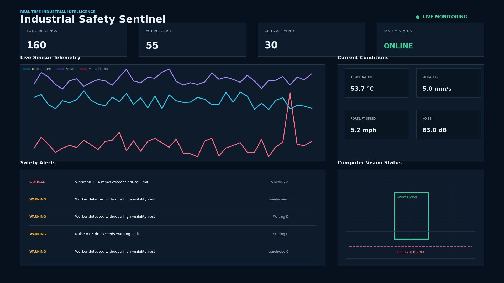
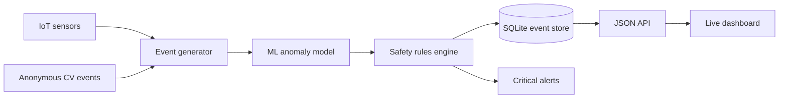

# Industrial Safety Sentinel

[**Open the live Vercel demo**](https://industrial-safety-sentinel.vercel.app/)

The hosted demo replays recorded synthetic events with precomputed model scores and alerts. It is separate from the local Python service described below.

[](https://github.com/Rajdev-teach/industrial-safety-sentinel/actions)
[](https://python.org)
[](LICENSE)

**A real-time industrial workplace safety platform combining IoT telemetry, anonymous computer-vision events, machine-learning anomaly detection, automated alerting, and incident analytics.**



## Business problem

Factories generate safety signals across cameras, machines, forklifts, and environmental sensors. These signals often remain separated until an incident occurs. Industrial Safety Sentinel unifies them into one operational view and prioritizes actionable risks: missing PPE, restricted-zone entry, unsafe speed, excessive vibration, heat, and noise.

This project connects my **Mechanical Engineering foundation** with **Information Systems, Python, data engineering, machine learning, and industrial analytics**.

## Live architecture



## What it detects

- Machine temperature above warning and critical limits
- Excessive vibration associated with mechanical risk
- Unsafe forklift speed
- High workplace noise
- Workers missing helmets or high-visibility vests
- Anonymous worker entry into restricted machine zones
- Unusual multivariate sensor patterns using Isolation Forest

No facial recognition is used. Computer-vision events use anonymous worker identifiers and synthetic data.

## Technology

| Area | Implementation |
|---|---|
| Real-time ingestion | Python event producer with one-second streaming |
| IoT/CV simulation | Reproducible multi-zone data generator |
| Machine learning | Scikit-learn Isolation Forest |
| Rules engine | Configurable warning and critical thresholds |
| Database | Indexed SQLite event and alert tables |
| API | Python threaded HTTP JSON endpoints |
| Dashboard | Responsive HTML, CSS, Canvas and JavaScript |
| Quality | Pytest, GitHub Actions and deterministic fixtures |

## Deploy the demo on Vercel

**Production:** [industrial-safety-sentinel.vercel.app](https://industrial-safety-sentinel.vercel.app/) — published November 18, 2026.

This release was uploaded as a tested static build. Automatic redeployment from GitHub is not connected; re-upload the generated `web-dist/` output after updates, or connect the repository to enable it.

Import this repository in Vercel with the repository root as the project root. The committed `vercel.json` builds a static replay with Node.js and publishes **web-dist**. It does not install Python packages or run the live Python server. No application secrets or external database are required for this recorded demo.

The Vercel version is explicitly labeled **recorded synthetic replay**. It plays 160 committed synthetic events whose Isolation Forest scores and rule alerts were computed offline with the real project code. Pause, resume, and restart controls let a recruiter inspect the sequence. Timestamps are recording timestamps. Replaying does not create new telemetry or run live inference.

The local Python application continues to simulate a live feed with SQLite persistence and model inference. That long-running process and local SQLite file are not suitable for Vercel Functions as-is. A production live deployment needs hosted persistence and an ingestion service.

```sh
npm run build
```

To regenerate the recording after changing the detector or model, install the Python requirements and run `python scripts/record_web_demo.py`, review the generated data, and commit it. The Vercel build uses the reviewed recording.

When connected to a Vercel project, the production branch can deploy automatically on GitHub pushes under that project's settings. Repository configuration alone does not establish a live deployment.

## Run locally

Install [Git](https://git-scm.com/downloads) and [Python 3.10 or newer](https://www.python.org/downloads/) first. If `git` or `python` is not recognized, finish the installation, reopen your terminal (or restart VS Code), and check `git --version` and `python --version` before continuing.

### Windows (PowerShell)

Run these commands from the folder where you want to keep the project:

```powershell
git clone https://github.com/Rajdev-teach/industrial-safety-sentinel.git
cd industrial-safety-sentinel
python -m venv .venv
.\.venv\Scripts\python.exe -m pip install -r requirements.txt
.\.venv\Scripts\python.exe scripts/seed_demo.py
.\.venv\Scripts\python.exe -m safety_sentinel.server
```

These commands use the virtual environment's Python directly, so activation and PowerShell execution-policy changes are not required.

### macOS / Linux (Bash)

```bash
git clone https://github.com/Rajdev-teach/industrial-safety-sentinel.git
cd industrial-safety-sentinel
python3 -m venv .venv
source .venv/bin/activate
python -m pip install -r requirements.txt
python scripts/seed_demo.py
python -m safety_sentinel.server
```

Open `http://localhost:8000`. The producer adds a new reading every second and the dashboard refreshes every two seconds. Keep the server terminal open; press `Ctrl+C` to stop it.

## API endpoints

- `GET /api/metrics` — total readings, alerts, critical and open events
- `GET /api/readings` — latest sensor and anonymous vision readings
- `GET /api/alerts` — latest prioritized safety events

## Testing

```bash
pytest -q
```

The suite validates deterministic generation, threshold alerts, PPE and restricted-zone detection, ML anomaly detection, and database persistence.

## Demo

[Download the short dashboard demonstration](docs/industrial-safety-demo.mp4)

The repository includes a seeded screenshot and short MP4 showing simulated live monitoring. All people, events, sensors, and locations are synthetic.

## Production roadmap

- Replace the generator with MQTT/Kafka ingestion
- Add YOLO PPE detection at an edge device
- Use PostgreSQL/TimescaleDB for high-volume telemetry
- Add authentication, role-based access, encryption, and audit retention
- Integrate SMS/Teams notifications and CMMS work orders
- Evaluate false alarms with safety specialists before operational use

## Responsible use

This is a portfolio demonstration, not a certified safety system. Production deployment requires validated sensors, approved camera governance, human review, documented thresholds, cybersecurity controls, and compliance with site policies and applicable regulations.

